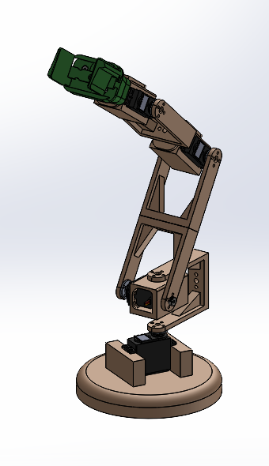
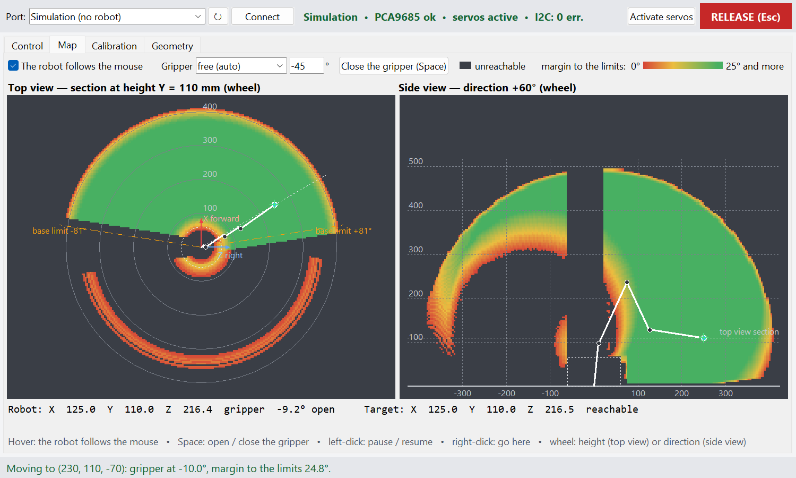
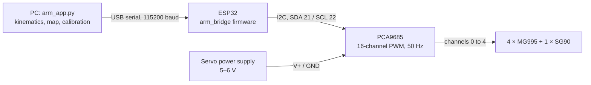
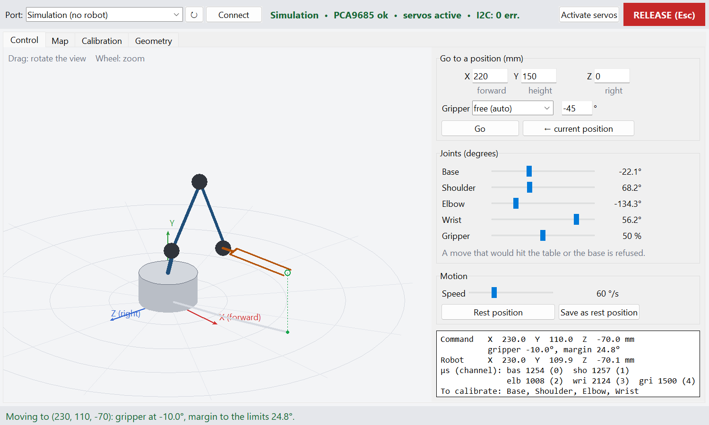
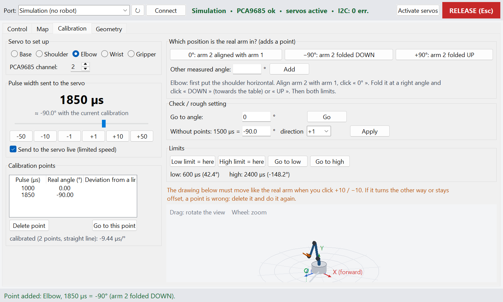

# BRASVF — 3D-printed 4-axis robot arm (ESP32 + PCA9685)

A 4-axis robot arm with a parallel gripper, designed in SolidWorks, 3D printed, driven by hobby servos (4 × MG995 + 1 × SG90) through an ESP32 and a PCA9685 PWM driver. A Python desktop application computes the kinematics, maps every reachable position, lets you drive the arm with the mouse and calibrates each servo.

<p align="center">
  
  
</p>

## Contents

- [How it works](#how-it-works)
- [Hardware](#hardware)
- [Wiring](#wiring)
- [Which code goes on the ESP32](#which-code-goes-on-the-esp32)
- [Control application](#control-application)
- [First start](#first-start)
- [Kinematic model](#kinematic-model)
- [Safety](#safety)
- [Repository layout](#repository-layout)
- [Serial protocol](#serial-protocol)
- [Credits and licences](#credits-and-licences)

## How it works



- **The PC does the maths.** The application (`07_Application`) turns a position (X, Y, Z) into joint angles, checks the path against the joint limits, the table and the base, then turns the angles into pulse widths with the calibration of each servo.
- **The ESP32 does the motion.** The `arm_bridge` firmware receives pulse widths and moves all the servos together, in a straight line in joint space, with limited speed and acceleration. It reads back every I2C write and repairs the PCA9685 if it gets disturbed.
- **The servos have no position sensor.** The application only knows the pulses it sends; that is why each servo is calibrated (pulse width → real angle) before use.

## Hardware

| Part | Qty | Role |
|---|---|---|
| TowerPro MG995 servo | 4 | base, shoulder, elbow, wrist |
| SG90 micro servo | 1 | gripper |
| ESP32 DevKit (ESP32-WROOM, USB CP210x) | 1 | serial link with the PC, I2C master |
| PCA9685 16-channel PWM board | 1 | generates the servo pulses (50 Hz) |
| 5–6 V power supply for the servos | 1 | separate from the ESP32, common ground; an MG995 can draw about 2.5 A when it stalls |
| 3D-printed parts | — | STL / 3MF files in `01_Arm`, `05_Gripper` |
| McMaster-Carr 90265A189 shoulder screws | — | used in the arm assemblies (the other McMaster models belong to the old gripper or are spare: see `03_Purchased_parts/McMaster_references.txt`) |

## Wiring

Recommended wiring (the pins are the ones used by the firmware):

| ESP32 | PCA9685 |
|---|---|
| 3V3 | VCC |
| GND | GND (common with the servo supply) |
| GPIO 21 | SDA |
| GPIO 22 | SCL |

The servo supply goes to the V+ / GND terminal block of the PCA9685. Default channels (they can be changed in the Calibration tab):

| Channel | 0 | 1 | 2 | 3 | 4 |
|---|---|---|---|---|---|
| Servo | base | shoulder | elbow | wrist | gripper |

## Which code goes on the ESP32

| Folder | Use it when | What it does |
|---|---|---|
| `06_ESP32/arm_bridge` | **with the PC application (recommended)** | Serial bridge: smooth synchronised motion, I2C write check, PCA9685 recovery, keeps the arm held after an ESP32 reboot |
| `06_ESP32/arm_ik` | without a PC application | Standalone inverse kinematics: type `200 150 80` in the serial monitor and the arm goes there (its calibration is in the code) |
| `06_ESP32/servo_test` | to test one servo | Puts one PCA9685 channel at a given angle and holds it |

Upload with the Arduino IDE: board **ESP32 Dev Module**, ESP32 core 3.x (compiled with 3.3.12). No library is needed: the PCA9685 is driven directly through its registers.

After uploading `arm_bridge`, open the serial monitor at 115200 baud and type `?`: the answer must start with `BRIDGE 1 pca=ok`. **Close the serial monitor afterwards**: only one program at a time can use the COM port.

## Control application

<p align="center">
  
  
</p>

```
pip install numpy pillow pyserial
python 07_Application/arm_app.py
```

Without `pyserial`, or without a robot, choose **Simulation (no robot)**: a simulated arm runs the same firmware logic.

- **Control**: go to a position X, Y, Z (mm) with the gripper free, horizontal, pointing down or at a fixed angle; move each joint with a slider; speed setting; rest position.
- **Map**: every reachable position, seen from above at height Y (mouse wheel) and from the side in the direction of the mouse. Grey = unreachable; red to green = margin to the servo limits.
  - The robot follows the mouse along a continuous path. Out of reach, it goes to the nearest reachable point.
  - Left-click: pause / resume. Right-click: go here (posture change allowed). **Space bar**: open / close the gripper.
- **Calibration**: limits of each servo, and pulse width → real angle points, added by clicking the button that describes the position of the real arm ("arm 2 folded DOWN", …). A live 3D view shows the arm as the application understands it.
- **Geometry**: arm dimensions and safety margins.

The calibration is saved in `07_Application/arm_config.json` (kept out of the repository: it is specific to each robot).

## First start

1. **Measure H0** (Geometry tab): height between the table and the centre of the shoulder servo axis. The CAD model gives 97.4 mm with base V2, but it must be checked on the real arm: an error on H0 shifts every height.
2. **Calibrate** each joint (Calibration tab), in this order: shoulder, elbow, wrist, base, then the gripper. For each joint: two clearly different reference positions, then the two limits. The default calibration is only a guess.
3. **Activate**: put the arm by hand close to the grey posture of the 3D view, then click **Activate servos** (the servos jump to it at once).
4. **RELEASE** (red button or Esc key) cuts the pulses: the servos become free and the arm can fall.

## Kinematic model

- Frame: origin on the table, on the base axis; **X forward, Y up, Z right**.
- Angles: base (0° = forward, positive to the right), shoulder (arm 1 relative to the horizontal), elbow (arm 2 relative to the extension of arm 1), wrist (gripper relative to the extension of arm 2). Gripper pitch φ = shoulder + elbow + wrist.

| Dimension | Value (mm) | Description |
|---|---|---|
| L1 | 153.86 | shoulder axis → elbow axis |
| L2 | 120.39 | elbow axis → wrist axis |
| L3 | 124.86 | wrist axis → fingertips |
| HP | 1.5 | fingertips offset perpendicular to the gripper |
| R0 | 10.25 | shoulder axis in front of the base axis |
| H0 | 97.4 | shoulder axis height (CAD estimate, to be measured) |
| C | 21.75 | total sideways offset (3 × 7.25) |

Inverse kinematics (`07_Application/kinematics.py`):
- every gripper pitch is tried (2° grid, then refined to 0.01°), with both elbow solutions and both sides (towards the target / over the shoulder);
- solutions outside the joint limits, touching the table (servo bodies and gripper outline included) or entering the base zone are discarded;
- the remaining one with the lowest cost is kept: far from the limits when going to a position, closest to the current posture when following the mouse (no sudden jump);
- about 3 ms per solve; the map of reachable positions is computed once in the arm plane and read for any view.

The first MATLAB model of the arm is in `04_Teleoperation/kinematics_matlab`.

## Safety

- Before each command, the application checks the path the servos will really follow (straight line in joint space), not only the final position. A move may leave a forbidden zone but never enter one.
- If the direct path of a "Go" move would hit something, the arm goes through the rest position.
- When following the mouse, a sudden change of posture is refused (right-click is needed).
- During calibration these checks are off: you drive the servo directly.

## Repository layout

```
00_Assembly/           full SolidWorks assemblies (arm V2 with the new gripper, arm V1 with the old gripper)
01_Arm/                arm parts: CAD (SolidWorks), STL, Gcode (sliced 3MF)
02_Old_gripper/        first gear gripper (CAD), replaced by 05_Gripper
03_Purchased_parts/    models of the bought parts: servos, horns, screws, bearing
04_Teleoperation/      notes on stereo-camera teleoperation + MATLAB kinematics
05_Gripper/            parallel gripper (Techniccontroller, MIT): CAD, STL, Gcode, images
06_ESP32/              ESP32 firmware (arm_bridge, arm_ik, servo_test)
07_Application/        Python control application
docs/images/           pictures used in this README
```

The main assembly `00_Assembly/Arm_V2_new_gripper.SLDASM` still uses base V1; the new base is the sub-assembly `01_Arm/CAD/Base_V2_assembly.SLDASM` (parts `MG995_base_servo_mount_V2`, `Base_horn_ring_V2`, `Base_horn_cover_V2`).

## Serial protocol

`arm_bridge` firmware, 115200 baud, one command per line:

| Command | Effect |
|---|---|
| `?` | status and positions |
| `T u0 u1 u2 u3 u4` | new targets in µs (0 = unchanged), synchronised follower |
| `M duration_ms u0 … u4` | synchronised move with a smooth start and stop |
| `P channel us` | direct pulse width |
| `V speed acceleration` | follower limits (µs/s, µs/s²) |
| `O` / `O channel` | release |

Messages: `pos u0 … u4` (10 times per second while moving), `done`, `ok`, `err …`.

## Credits and licences

- **Gripper** (`05_Gripper`): "Micro Servo Parallel Gripper" by Techniccontroller, MIT licence (see `05_Gripper/LICENSE.txt`). Sources: [GrabCAD](https://grabcad.com/library/micro-servo-parallel-gripper-1), [techniccontroller.com](https://techniccontroller.com/3d-printed-parallel-gripper/).
- **Purchased part models** (`03_Purchased_parts`): servo and horn models downloaded from the GrabCAD Community (credit to their authors; see each model's page for its terms), and McMaster-Carr parts (two of them modelled from the McMaster data sheets).

Author: Paco Tiberghien.
